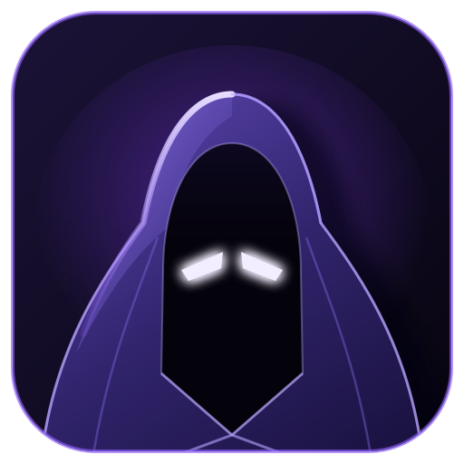

<p align="center">
  
</p>

<h1 align="center">varjo</h1>

<p align="center">
  <strong>Your development shadow.</strong><br>
  An always-on Claude Code agent on a spare Mac that watches your pull requests and works while you are away.
</p>

<p align="center">
  <a href="https://github.com/abyssparanoia/varjo/issues/18">Status: Phase 0 (technical validation)</a> ·
  <a href="docs/requirements.md">Requirements</a> ·
  <a href="https://github.com/abyssparanoia/varjo/issues?q=is%3Aissue+label%3Aepic">Roadmap</a> ·
  <a href="LICENSE">Apache-2.0</a>
</p>

---

*varjo* is Finnish for *shadow*. The idea is simple: a spare MacBook Pro sits in a drawer with the lid closed and runs [Claude Code](https://docs.claude.com/en/docs/claude-code) around the clock. It follows your work like a shadow, picks up pull request reviews as they arrive, prepares a summary and a proposed response, and lets you continue the conversation from your main machine or your phone.

> **Status:** pre-alpha. Nothing is runnable yet. The project is in Phase 0, validating which parts can be done with official Claude Code features alone. See [the Phase 0 tracking issue](https://github.com/abyssparanoia/varjo/issues/18).

## What it does

- **Watches your pull requests** across multiple repositories and detects new reviews, inline comments, replies, and *Changes Requested*. Polling only, no webhook server.
- **Works in isolation.** Each PR gets its own Git worktree checked out at the PR head, with the repository's `CLAUDE.md` and `.claude/rules/` applied as-is.
- **Summarizes and proposes.** Claude Code reads the review and produces a structured summary: severity, findings, affected files, a proposed approach, and the questions only you can answer.
- **Notifies you and keeps the session open.** You get a notification on your main machine and can jump into the related Claude Code session from Claude Desktop or your phone to give further instructions or approve a fix.
- **Carries context between machines.** Project memory and per-PR handoff notes flow between your everyday Mac and the agent machine, without ever syncing credentials or session history.

Later phases add applying fixes after human approval, starting new tasks from a phone, and adapters for other event sources such as Jira and CI.

## What it is not

varjo is **not** a custom AI agent platform and does not try to be one.

- It does not reimplement anything Claude Code already provides. Sessions, memory, project rules, skills, hooks, and the GUI all come from Claude Code and Claude Desktop.
- It does not call the Claude API on a pay-as-you-go basis. It runs on a Claude Code Max subscription.
- It does not expose any public server or inbound port on the agent machine.
- It does not auto-reply to reviews or push code without a human saying so.

What varjo builds is the thin layer in between: event monitoring, deduplication and state, worktree and session bookkeeping, notifications, and context sharing.

## How it works

```
   ┌──────────────┐        ┌──────────────────────────────────────┐
   │   mainPC     │  SSH / │   botPC  (spare Mac, lid closed)     │
   │ Claude       │◄──────►│                                      │
   │ Desktop      │ Remote │  launchd ─► poller ─► SQLite state   │
   └──────────────┘ Control│                 │                    │
                           │                 ▼                    │
   ┌──────────────┐        │  worktree per PR ─► Claude Code      │
   │  smartphone  │◄──────►│         ▲                │           │
   │ Claude app   │        │         │                ▼           │
   └──────────────┘        │  CLAUDE.md, rules,   summary +       │
                           │  memory, handoff     notification    │
                           └──────────▲───────────────────────────┘
                                      │ gh / GitHub API (polling)
                               ┌──────┴──────┐
                               │   GitHub    │
                               │ PR reviews  │
                               └─────────────┘
```

- **botPC** is the agent machine. It runs the poller, keeps state, manages worktrees, and executes Claude Code.
- **mainPC** is your everyday machine. Claude Desktop is the GUI. Nothing custom is installed if the official remote features are enough.
- **Smartphone** is the fallback client for when the main machine is not around.

Connectivity preference, in order: Claude Remote Control, Claude Desktop's SSH connection, then a private Tailscale network. No public inbound ports in any case.

## Principles

1. **Reuse Claude Code.** If an official feature does the job, use it. A custom chat UI is the last resort.
2. **Minimal surface.** Build only event monitoring, context sharing, and orchestration.
3. **Human in the loop.** Summaries are automatic. Pushes, replies, and production changes are not.
4. **Least privilege.** Scoped GitHub tokens, no direct pushes to `main`, no credential sync.
5. **Untrusted input.** PR comments and review bodies are data, never instructions.
6. **Idempotent and recoverable.** Every event is processed at most once and every failure can be retried, including after a reboot.

## Roadmap

| Phase | Goal | Tracking |
|---|---|---|
| 0 | Technical validation: can this be built from official Claude Code features? | [#18](https://github.com/abyssparanoia/varjo/issues/18) |
| 1 | GitHub review MVP: detect, summarize, notify | [#19](https://github.com/abyssparanoia/varjo/issues/19) |
| 2 | Review fixes: change, test, push after approval | [#20](https://github.com/abyssparanoia/varjo/issues/20) |
| 3 | Context sharing: Auto Memory and per-PR handoff between machines | [#21](https://github.com/abyssparanoia/varjo/issues/21) |
| 4 | Mobile and external integrations: tasks from a phone, Jira, browser automation | [#22](https://github.com/abyssparanoia/varjo/issues/22) |

The single most important open question is whether a Claude Code session created non-interactively on botPC can be opened and continued from Claude Desktop on another machine. That is [#11](https://github.com/abyssparanoia/varjo/issues/11). If the answer is no, the architecture changes before any code is written.

## Documentation

- [Requirements and implementation plan](docs/requirements.md)
- Research notes and validation runbooks will land under `docs/` as Phase 0 progresses.

## Contributing

Ideas, questions, and reports of what works on your setup are welcome as [issues](https://github.com/abyssparanoia/varjo/issues). There is no code to contribute to yet, so there is no contributing guide. One will appear once Phase 1 starts.

## License

[Apache License 2.0](LICENSE)
